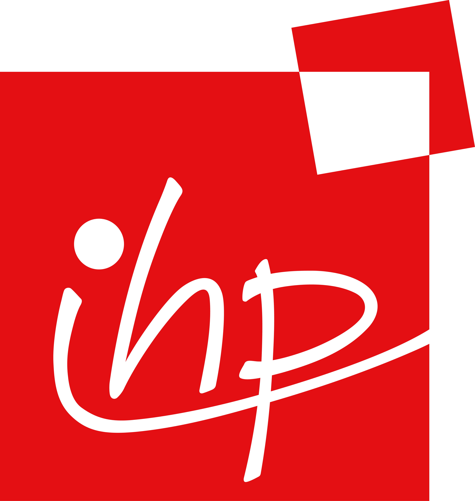

IHP Open Assembly Design Kit documentation
==========================================

.. image:: https://img.shields.io/github/license/IHP-GmbH/IHP-Open-ADK
   :alt: License - Apache 2.0
   :target: https://github.com/IHP-GmbH/IHP-Open-ADK

Documentation source for the IHP Open Assembly Design Kit (ADK) and the open
flow for 2.5D heterogeneous chiplet integration built around it.

.. |current-status| replace:: **Preview Release**

Current Status: |current-status|
================================

.. warning::
   The IHP Open ADK is a preview release. The interposer process has been
   fabricated several times at IHP, which is a statement about process maturity
   rather than about a complete assembly. The kit is not intended for production
   assembly design at this moment.

About
=====

An Assembly Design Kit is to a package what a Process Design Kit is to a die. A
PDK says whether a shape can be manufactured on a process. The ADK says whether
a die may sit at a given place, at a given spacing from its neighbours, attached
by a given method. The ADK sits one abstraction layer above every PDK, and the
interposer and the chiplet dies remain ordinary PDKs.

This repository holds only documentation. The code it documents lives in the
repositories pinned as submodules under ``src/``:

- `IHP-Open-ADK <https://github.com/IHP-GmbH/IHP-Open-ADK>`__, the assembly rules and tooling
- `chiplet-spec <https://github.com/IHP-GmbH/chiplet-spec>`__, the ``.chiplet`` interchange format
- `OpenIntM4TM2 <https://github.com/IHP-GmbH/OpenIntM4TM2>`__, the interposer PDK
- `IHP-Interconnect-IntM4TM2 <https://github.com/IHP-GmbH/IHP-Interconnect-IntM4TM2>`__, the attachment method registry
- `KiCad-ADK-MOD <https://github.com/IHP-GmbH/KiCad-ADK-MOD>`__, the KiCad fork
- `Chiplets-KiCad-Plugin <https://github.com/IHP-GmbH/Chiplets-KiCad-Plugin>`__, the export plugin and GDS generation
- `gds2kicad <https://github.com/IHP-GmbH/gds2kicad>`__, die GDS to KiCad conversion
- `chiplet-studio <https://github.com/IHP-GmbH/chiplet-studio>`__, the 3D assembly viewer
- `ADK-Tools <https://github.com/IHP-GmbH/ADK-Tools>`__, the container that pins and builds them all

The base process PDK is documented separately at
https://ihp-open-pdk-docs.readthedocs.io.

Prerequisites
=============

- Git 2.35 or newer
- Python 3.10 or newer

Building locally
================

.. code:: bash

   git clone --recurse-submodules https://github.com/IHP-GmbH/IHP-Open-ADK-docs.git
   cd IHP-Open-ADK-docs

   python3 -m venv .venv
   .venv/bin/pip install -r docs/requirements.txt

   # Regenerate the tables and command transcripts from the pinned sources,
   # then build. The build must be warning free.
   make -C docs preprocess
   .venv/bin/sphinx-build -b html -W --keep-going docs docs/_build/html

Open ``docs/_build/html/index.html``. ``make -C docs docs`` runs the whole chain
and opens the result.

Generated content
=================

Nothing normative on this site is typed by hand. ``docs/scripts/`` reads the
pinned submodules and writes the rule tables, adapter tables, version matrices
and command line transcripts. The generators fail the build when the source
drifts from what is documented, for example when a rule is added to a deck
without a matching description. Continuous integration re-runs them and fails if
the working tree is then dirty, which is what proves the published tables match
the pinned revisions.

Contributing
============

The "Contributing to this documentation" page of the built site
(``docs/contrib/02_documentation.rst``) carries the authoring contract,
including the constraints that are factual or legal rather than stylistic. Read
it before opening a pull request.

License
=======

Copyright 2026 IHP Open ADK Authors.

Licensed under the Apache License, Version 2.0. You may obtain a copy of the
License at https://www.apache.org/licenses/LICENSE-2.0.

Unless required by applicable law or agreed to in writing, software distributed
under the License is distributed on an "AS IS" BASIS, WITHOUT WARRANTIES OR
CONDITIONS OF ANY KIND, either express or implied. See the License for the
specific language governing permissions and limitations under the License.
